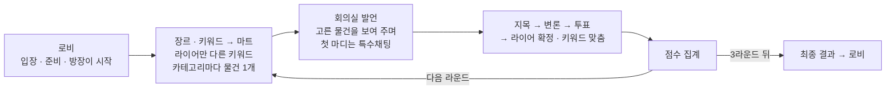

# 시장에 가면 (Unity-3D-IfIWasInMarket)

**마트에서 각자 물건을 골라 와 회의실에서 소개하며, 혼자 다른 키워드를 받은 라이어를 찾아내는 4인 온라인 추리 게임**

Unity 6 · C# · WebSocket · 4인 팀 프로젝트 (클라이언트 담당) · 2026.08.26 ~ 2026.09.10

▶ **시연 영상**: https://www.youtube.com/watch?v=5ojDbp9maf0

> 이 프로젝트는 4인 팀 프로젝트(`3rd-TeamProject-SH`)로 시작했으며, 저(김진우)는 그중 **라이어게임 파트의 클라이언트**(턴 진행, UI, 채팅, 조명·사운드 연결)를 맡았습니다.
> 이 저장소는 팀 프로젝트를 Fork해 개인 포트폴리오용으로 정리한 것입니다.
> 제 코드는 `Assets/10. Scripts/06. Server And WebSocket/KJW_LIARGAME/Scripts`에 있습니다.

---

## 게임 소개

4명이 3라운드 동안 라이어 한 명을 찾는 온라인 라이어게임입니다.
라이어만 다른 키워드를 받고, 모두 마트에서 키워드에 어울리는 물건을 골라 와 회의실에서 그 물건을 보여 주며 발언합니다.
라이어는 **자기가 라이어인 줄 모르는 채로** 시작하고, 발언 중에 '내가 라이어 같다'고 짐작되면 **라밍아웃 버튼**을 눌러 큰 점수 차를 뒤집을 수 있습니다.

## 게임 진행 흐름

1. **로비** — 방 코드로 입장하고, 모두 준비하면 방장이 시작합니다.
2. **장르·키워드 받기** — 장르가 공개되고, 라이어에게만 다른 키워드가 전달됩니다.
3. **마트** — 카테고리마다 물건을 하나씩 고르고, 개인 퀘스트(지정된 물건 찾기)를 수행합니다. 다른 플레이어를 밀칠 수도 있습니다.
4. **회의실 발언** — 차례대로 고른 물건을 보여 주며 발언합니다. 첫 마디는 특수채팅으로 모두에게 공개됩니다. 발언은 카테고리마다 한 바퀴씩, 한 라운드에 3바퀴 돕니다.
5. **지목 & 변론** — 라이어로 의심되는 사람을 지목하고, 가장 많이 지목된 사람은 변론합니다.
6. **투표** — 맞다 / 모르겠다 / 아니다로 투표해 라이어를 확정합니다.
7. **라이어의 최후** — 라이어로 확정되면 시민의 키워드를 맞힐 기회를 얻습니다. 맞히면 부활하고, 못 맞히면 시민이 이깁니다.
8. **점수 집계 & 최종 결과** — 투표 성공, 라이어의 키워드 맞춤, 라밍아웃, 개인 퀘스트 성공 여부를 서버가 합산합니다. 3라운드 뒤 최종 결과를 보여 주고 로비로 돌아갑니다.

## 조작

| 상황 | 입력 | 동작 |
|---|---|---|
| 마트 | WASD · F · Space · Q | 이동 · 물건 집기/내려놓기 · 밀치기(물건을 든 동안은 불가) · 고른 물건 목록 |
| 회의실 | TAB (누르는 동안) | 정보창: 이번 라운드 내 물건 목록, 특수채팅 기록 |
| 회의실 | 마우스 왼쪽 클릭 · 버튼 | 지목(같은 사람을 다시 누르면 취소) · Skip · 투표 · 라밍아웃 |

## 담당 파트

- **턴 메시지 처리** — 서버가 보내는 턴 상태 22종을 받아 투표·Skip 버튼·조명·안내·BGM을 상태마다 한곳에서 정해진 순서로 처리 (`LiarClient`)
- **클라이언트 UI** — 로비 / 공통(타이머·채팅·TAB 정보창) / 회의실 UI를 매니저 3개로 나눠 설계 (`LobbyUIManager`, `CommonUIManager`, `MeetingRoomUIManager`), 공지 패널
- **채팅 3종 자동 판별** — 입력창 하나로 일반·특수·키워드 채팅을 보내고, 어떤 채팅인지는 지금 상태와 말하는 사람으로 정함
- **라밍아웃 버튼** — 누른 사람에게는 안내를 바로 띄우고, 점수 판정과 라이어 공개는 서버가 알린 순간에 4명에게 똑같이 보여 줌
- **조명·사운드 연출 연결** — 장면·지목·투표·최종 결과에 맞춰 BGM을 바꾸고 효과음·조명을 연결, 볼륨 슬라이더 연동 (`SoundManager`·`LightManager`는 백성현 님 작성)
- **버그 수정 및 안정화** — 씬 전환 시 오디오 리스너 중복·오디오 크래클링, 데이터 로드 레이스 컨디션, 플레이어별 색상 일관성 등 동기화 버그 진단 및 수정
- **리팩터링** — 서버 프로토콜 변경에 맞춰 구조 정리

## 팀 구성

| 팀원 | 맡은 부분 |
|---|---|
| 백성현 | 회의실·마트 맵, UI 디자인, `LightManager`·`SoundManager`, 타이틀·튜토리얼, `main` 병합 |
| 김민성 | 게임 서버(ASP.NET Core WebSocket)와 턴 메시지 프로토콜, 장르·키워드·물건 데이터 테이블, 마트 매대·물건 배치, 준비(Ready) 기능 |
| 나정원 | 캐릭터 이동·애니메이션, 물건 집기·내려놓기·밀치기와 서버 연동, 지목 화살표·투표 시스템, 플레이어 색상 |
| **김진우 (본인)** | 라이어게임 클라이언트 — 턴 상태 처리, UI 매니저와 공지 패널, 채팅 3종, 조명·BGM·효과음 연결, 리팩터링 |

## 사용 기술

| 항목 | 내용 |
|---|---|
| 엔진 · 언어 | Unity 6 (6000.3.15f1), URP · C# |
| 주요 패키지 | UniTask(비동기 처리), Newtonsoft.Json, DOTween, uGUI + TextMeshPro, Input System |
| 네트워크 | WebSocket 실시간 통신 |
| 서버 | ASP.NET Core WebSocket 서버 (김민성 님 작성, 별도 저장소) |
| 협업 도구 | GitHub 조직 저장소, Fork(Git 클라이언트), Asana, JetBrains Rider |
| 규모 | 담당 스크립트 7개 약 3,500줄, 그중 본인 작성 약 2,500줄 |
